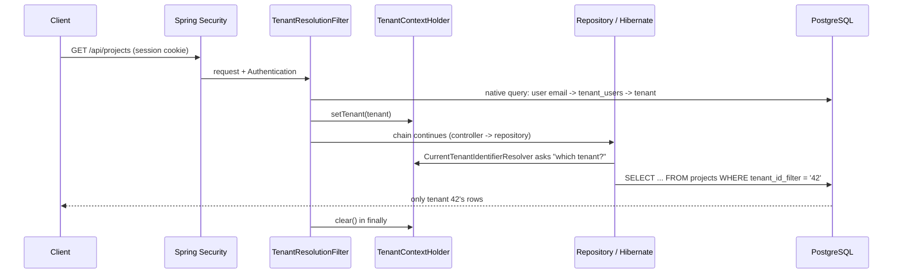

# spring-boot-multitenant-starter

[](https://github.com/JulioLabs/spring-boot-multitenant-starter/actions/workflows/test.yml)
[](LICENSE)

How to wire **Spring Boot 3 and Hibernate 6 together for multi-tenancy** with a shared schema and a discriminator column, so repositories and services never mention the tenant and one tenant can't read another's rows.

The code is the tenancy plumbing from [PresenceWave](https://presencewave.com), a multi-tenant SaaS running in production, trimmed to the parts that matter and covered by isolation tests against a real PostgreSQL.

> **Reference code, not a library.** Read it, run the tests, and copy the patterns you need. It isn't published to any artifact repository, and it isn't a complete application: there's no controller or login setup, only the tenancy wiring and the tests that prove it.

## Run it in two minutes

Requirements: **JDK 21** and **Docker** (the tests start PostgreSQL 16 with Testcontainers). Nothing else: the Gradle wrapper downloads Gradle.

```bash
git clone https://github.com/JulioLabs/spring-boot-multitenant-starter.git
cd spring-boot-multitenant-starter
./gradlew test
```

`TenantIsolationIntegrationTest` creates two tenants, writes data as one and reads it as the other. Each test is one guarantee:

| Test | What it proves |
|---|---|
| `save_WithTenantContext_StampsTheCurrentTenant` | Saving an entity fills in the current tenant. Application code never passes it. |
| `queries_AsAnotherTenant_DoNotSeeTheRows` | Tenant B can't see tenant A's rows through `findAll`, `findById` (even with the exact id) or a derived query. |
| `queries_WithoutTenantContext_SeeNothing` | Forgetting to set a tenant returns nothing, not everything: it fails closed. |
| `queries_InPublicRequestMode_SeeEveryTenant` | The deliberate exception: a "public request" switches filtering off. |
| `save_WithEntityOfAnotherTenant_IsRejected` | Saving an entity that points at another tenant throws. |

The test report is in `build/reports/tests/test/index.html`.

To see the SQL Hibernate generates, run the tests with SQL logging on:

```bash
SPRING_JPA_SHOW_SQL=true ./gradlew test --rerun-tasks -i | grep "Hibernate:.*from projects"
```

```sql
select ... from projects p1_0 where p1_0.tenant_id_filter = ?                     -- findAll() as a tenant
select ... from projects p1_0 where p1_0.tenant_id_filter = ? and p1_0.name = ?   -- findByName("alpha")
select ... from projects p1_0                                                     -- findAll() in a public request (root mode)
```

The repository code is the same in all three. Only the tenant context differs.

## The idea in one picture



Nothing in a repository or service mentions the tenant. Hibernate adds the predicate, and fills the column on insert, because every tenant-scoped entity extends `TenantAwareEntity`. This is all a tenant-scoped entity and its repository need:

```java
@Entity
@Table(name = "projects")
public class Project extends TenantAwareEntity {   // the whole opt-in
  private String name;
}

public interface ProjectRepository extends JpaRepository<Project, Long> {
  List<Project> findByName(String name);            // no tenant parameter anywhere
}
```

## Reading order

Each file is short and commented. Read them in this order, from where the tenant is stored to how it reaches the SQL:

1. [`TenantContextHolder`](src/main/java/com/example/multitenant/tenant/TenantContextHolder.java): the per-thread holder for the current tenant and the "public request" flag.
2. [`CurrentTenantIdentifierResolverImpl`](src/main/java/com/example/multitenant/tenant/CurrentTenantIdentifierResolverImpl.java): tells Hibernate the current tenant id. Falls back to `"-1"`, which matches nothing, so it fails closed. `isRoot()` switches filtering off for public requests.
3. [`TenantAwareEntity`](src/main/java/com/example/multitenant/tenant/TenantAwareEntity.java): the base entity with the `@TenantId tenantIdFilter` discriminator, the `tenant_id` foreign key and timestamps.
4. [`PrimaryDataSourceConfig`](src/main/java/com/example/multitenant/config/PrimaryDataSourceConfig.java) and [`application.yml`](src/main/resources/application.yml): register the resolver on the EntityManagerFactory and set `hibernate.multiTenancy=DISCRIMINATOR`.
5. [`TenantResolutionFilter`](src/main/java/com/example/multitenant/web/TenantResolutionFilter.java) and [`TenantFilterConfig`](src/main/java/com/example/multitenant/web/TenantFilterConfig.java): resolve the tenant for each request, after Spring Security, and always clear it afterwards.
6. [`TenantAwareAspect`](src/main/java/com/example/multitenant/tenant/TenantAwareAspect.java): fills in the tenant on `save()` and rejects saving another tenant's entity.
7. [`TenantIsolationIntegrationTest`](src/test/java/com/example/multitenant/TenantIsolationIntegrationTest.java): the guarantees above, against PostgreSQL.

The rest is supporting code: `Tenant`, `TenantUser` and `User` (users are global; a `TenantUser` row links a user to a tenant), the example `Project` entity, and the schema in [`V1__tenancy_core.sql`](src/main/resources/db/migration/V1__tenancy_core.sql) with the tenancy columns and the indexes on the discriminator.

**Why it's built this way** (choosing an isolation model, the request lifecycle, the native bootstrap query, public requests, threads): [docs/architecture.md](docs/architecture.md).

## Layout

```
src/main/java/com/example/multitenant/
  tenant/    context holder, Hibernate resolver, base entity, save aspect, Tenant and TenantUser
  web/       request filter and its registration
  config/    DataSource / EntityManagerFactory wiring
  user/      minimal User
  example/   a tenant-scoped example entity and repository
src/main/resources/
  application.yml                    multi-tenancy settings only
  db/migration/V1__tenancy_core.sql  tables, tenancy columns, discriminator indexes
src/test/java/com/example/multitenant/
  TenantIsolationIntegrationTest.java
docs/architecture.md                 the design, step by step
```

Spring Boot 3.5, Hibernate 6.6, Java 21, PostgreSQL 16, Flyway, Lombok.

## Known limitations

The tenancy code is kept as it runs in production, rough edges included. They make good discussion points, so they're listed rather than hidden:

- **The tenant doesn't follow work onto other threads by default.** `TenantContextHolder` uses `TransmittableThreadLocal`, which only propagates through TTL-wrapped executors or the TTL Java agent, and neither is wired up here. `@Async` methods and scheduled jobs must set the tenant themselves and call `clear()` in a `finally` block.
- **`saveAll` isn't stamped or checked.** `TenantAwareAspect` only looks at the first argument, so `saveAll(collection)` bypasses the stamping and the cross-tenant check.
- **Public requests switch isolation off.** When the "public request" flag is set, `isRoot()` returns true and Hibernate stops adding the tenant predicate. Isolation for those requests depends on how the code looks things up.
- **Native queries bypass `@TenantId`.** `TenantUserRepository.findByUserEmail` relies on this on purpose, but any other native query must filter by tenant itself.
- **The discriminator column needs its own indexes.** Every query Hibernate generates filters on `tenant_id_filter`, so it should lead the index. The reference migration adds these; not every table in a real schema will have them.

## What changed from the production code

Most files are the production classes with only the package renamed. The exceptions:

- **`TenantResolutionFilter` is a rewrite.** The production filter also resolves tenants from the request host and from API tokens. Those branches were removed, leaving the session-based one.
- **`TenantAwareEntity`** no longer implements the application's event interface, and `Tenant`, `TenantUser` and `User` were reduced to the fields this reference needs.
- **`TenantContextHolder`** lost a flag that was written but never read.
- **`Project`, `ProjectRepository`, `V1__tenancy_core.sql` and `TenantIsolationIntegrationTest`** were written for this repo. They follow the production design but aren't copies of production files.
- Two comments were corrected where they contradicted the code (the filter-order comment in `TenantFilterConfig`, and the `validateExistingCurrentSessions` comment).

## Not included

- Custom domains, DNS verification and reverse-proxy setup. These are covered separately.
- Host-based tenant resolution, API-token authentication, invitations, and anything specific to a product.

## About

Maintained by the team behind [PresenceWave](https://presencewave.com), which helps local service businesses (cleaning, landscaping, electricians, dentists and more) capture more leads, understand their customers and bring them back, all from one platform.

Questions or corrections are welcome as [issues](https://github.com/JulioLabs/spring-boot-multitenant-starter/issues).

## License

[MIT](LICENSE)
