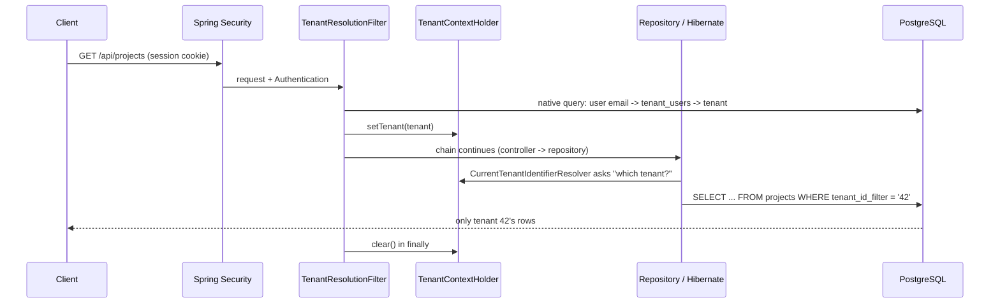

# spring-boot-multitenant-starter

**Maintained by the creators of [PresenceWave](https://presencewave.com).** PresenceWave helps local service businesses (cleaning, landscaping, electricians, dentists and more) capture more leads, understand their customers and bring them back, all from one platform.

Reference code showing how **Spring Boot and Hibernate are wired together for multi-tenancy** using a shared schema and a discriminator column.

> **This repo is reference material, not a library or a runnable project.**
> It is extracted from PresenceWave, a production multi-tenant SaaS, and trimmed to the tenancy plumbing so it can be read alongside a series of blog posts. It has **not been compiled or run in this form**, and the code is not published to any artifact repository. Use it to understand the design, not as a drop-in dependency.

## The idea in one picture



Nothing in a repository or service mentions the tenant. Hibernate adds the predicate, and stamps the column on insert, because every tenant-scoped entity extends `TenantAwareEntity`.

## How the pieces fit

| Piece | File | Role |
|---|---|---|
| Tenant context | `tenant/TenantContextHolder.java` | Per-thread holder for the current `Tenant` and a "public request" flag |
| Hibernate hook | `tenant/CurrentTenantIdentifierResolverImpl.java` | Tells Hibernate the current tenant id. Falls back to `"-1"` (matches nothing, so it fails closed). `isRoot()` turns filtering off for public requests |
| Base entity | `tenant/TenantAwareEntity.java` | `@TenantId tenantIdFilter` discriminator, plus the `tenant_id` foreign key and timestamps |
| Save-time guard | `tenant/TenantAwareAspect.java` | Stamps the tenant on `save()` and rejects saving another tenant's entity |
| Wiring | `config/PrimaryDataSourceConfig.java`, `application.yml` | Registers the resolver on the EntityManagerFactory and sets `hibernate.multiTenancy=DISCRIMINATOR` |
| Request entry point | `web/TenantResolutionFilter.java`, `web/TenantFilterConfig.java` | Resolves the tenant per request, always clears it afterwards |
| Membership | `tenant/Tenant.java`, `TenantUser.java`, `user/User.java` | Users are global; a `TenantUser` row links a user to a tenant |
| Example | `example/Project*.java` | A tenant-scoped entity and repository, showing that extending `TenantAwareEntity` is all it takes |
| Schema | `db/migration/V1__tenancy_core.sql` | The three tenancy columns and the discriminator indexes |
| Guarantees | `src/test/.../TenantIsolationIntegrationTest.java` | Tenant isolation checks against a real PostgreSQL |

Suggested reading order: `TenantContextHolder` → `CurrentTenantIdentifierResolverImpl` → `TenantAwareEntity` → `PrimaryDataSourceConfig` + `application.yml` → `TenantResolutionFilter` → `TenantAwareAspect` → the isolation test. A longer walkthrough is in [docs/architecture.md](docs/architecture.md).

## What was changed from the original code

Most files are the production classes with only the package renamed. The exceptions:

- **`TenantResolutionFilter` is a rewrite.** The production filter also resolves tenants from the request host and from API tokens. Those branches were removed, leaving the session-based one.
- **`TenantAwareEntity`** no longer implements the application's event interface, and `Tenant`, `TenantUser` and `User` were reduced to the fields this reference needs.
- **`TenantContextHolder`** lost a flag that was written but never read.
- **`Project`, `ProjectRepository`, `V1__tenancy_core.sql` and `TenantIsolationIntegrationTest`** were written for this repo. They follow the production design but are not copies of production files.
- Two comments were corrected where they contradicted the code (the filter-order comment in `TenantFilterConfig`, and the `validateExistingCurrentSessions` comment).

## Known limitations

The tenancy code is kept as it runs in production, including its rough edges. They make good discussion points, so they are listed rather than hidden:

- **Context does not follow work onto other threads by default.** `TenantContextHolder` uses `TransmittableThreadLocal`, which only propagates through TTL-wrapped executors or the TTL Java agent. Neither is wired up here. `@Async` methods and scheduled jobs must set the tenant themselves and call `clear()` in a `finally` block.
- **`saveAll` is not stamped or checked.** `TenantAwareAspect` only inspects the first argument, so `saveAll(collection)` bypasses the stamping and the cross-tenant check.
- **Public requests disable isolation.** When the "public request" flag is set, `isRoot()` returns true and Hibernate stops appending the tenant predicate. Isolation for those requests depends on code-level scoping.
- **Native queries bypass `@TenantId`.** `TenantUserRepository.findByUserEmail` relies on this on purpose, but any other native query must filter by tenant itself.
- **The discriminator column needs its own indexes.** The queries Hibernate generates all filter on `tenant_id_filter`, so it should lead the index. The reference migration adds these; not every table in a real schema will.

## Not included

- Custom domains, DNS verification and reverse-proxy setup. These are covered separately.
- Host-based tenant resolution, API-token authentication, invitations, and anything to do with a specific product.

## Layout

```
src/main/java/com/example/multitenant/
  tenant/    context holder, Hibernate resolver, base entity, aspect, Tenant and TenantUser
  web/       request filter and its registration
  config/    DataSource / EntityManagerFactory wiring
  user/      minimal User
  example/   a tenant-scoped example entity
src/main/resources/
  application.yml               (multi-tenancy settings only)
  db/migration/V1__tenancy_core.sql
src/test/java/com/example/multitenant/TenantIsolationIntegrationTest.java
build.gradle                    (dependency list, reference only)
```

## License

[MIT](LICENSE)
